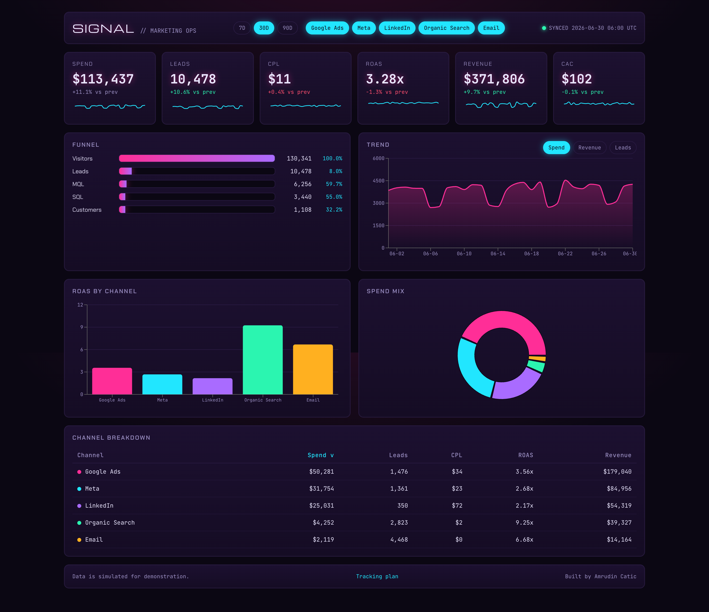

# Marketing Ops Dashboard

A full-funnel marketing ops command center, built to show how a marketing
engineer thinks about spend, leads, revenue, and the tracking plan that feeds
them, in one interactive view.

## What this demonstrates

- **Full-funnel marketing ops thinking.** Spend, CPL, ROAS, CAC, and CTR sit
  next to a Visitors to Leads to MQL to SQL to Customers funnel with
  stage-to-stage conversion rates, plus a per-channel breakdown across Google
  Ads, Meta, LinkedIn, Organic Search, and Email.
- **Interactive data engineering with client-side recompute.** Date-range
  presets and channel filters recompute every KPI, chart, and table row from
  the underlying rows in the browser, no server round trip. The data model
  and math live in `src/data/metrics.js` and are unit tested.
- **An analytics tracking plan.** A real event taxonomy, GTM dataLayer
  schema, and GA4 setup checklist live in `docs/analytics/`, written the way
  they would be handed to a data team, not as filler documentation.
- **Synthwave UI.** An 80s mission-control aesthetic (neon magenta and cyan
  on deep purple, glowing CRT-style KPI readouts that count up on filter
  change) built with design tokens rather than one-off styles.

## Screenshot



## Live link

Once this repository is pushed to GitHub and Pages is enabled for it, the
included workflow (`.github/workflows/deploy.yml`) deploys automatically on
every push to `main`. The site will be live at:

```
https://<your-username>.github.io/marketing-ops-dashboard/
```

## Running locally

```bash
npm install
npm run gen:data
npm run dev
```

Then open the local URL Vite prints in the terminal.

To run the test suite:

```bash
npm test
```

## Analytics tracking plan

See [`docs/analytics/`](docs/analytics/) for the full event taxonomy, GTM
dataLayer schema, metric definitions (matching the dashboard's math exactly),
and a GA4 and GTM setup checklist.

## Data is simulated

All data in this dashboard is generated by a seeded mock data script
(`npm run gen:data`), not pulled from a live ad account or CRM. It is shaped
to look and behave like real marketing data so the dashboard's interactivity
and math can be evaluated honestly, without exposing anyone's real campaign
numbers.
